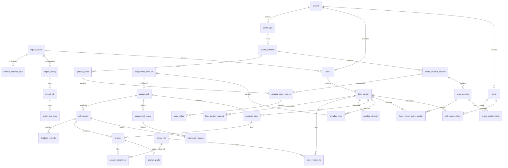

# Assignment Service — модель данных PostgreSQL

**Дата:** 27 ноября 2026 г.  
**Статус:** актуальная логическая модель (36 таблиц Assignment) после согласования API. Технические дополнения редакции выделены в §17. Не является готовыми SQL/Flyway-миграциями.  
**Основа:** `assignment_service_requirements.md`, четыре исходные ER-диаграммы и последующие согласования модели данных. Более поздние явно согласованные решения имеют приоритет над ранним разделом открытых вопросов требований.

## 1. Общие соглашения

- Собственная БД Assignment Service. UUID преподавателей, учеников, администраторов, курсов и материалов Education — внешние идентификаторы, не SQL FK к чужим БД.
- `PK` — первичный ключ; `FK` — внешний ключ в локальной БД; `NULL` — поле необязательно. Все поля без отметки `NULL` обязательны. UUID генерируются сервером; абсолютное время — `timestamptz`, UTC в API. Все баллы целочисленные.
- Статусы/коды представлены `text` с CHECK по допустимым значениям. JSONB валидируется по конкретному формату/типу; не используется как замена реляционным связям.
- Исторические ссылки защищаются FK с RESTRICT/NO ACTION. Каскад допустим для зависимых строк только в явно разрешённой операции физического удаления. Не использовать глобальные каскады, которые уничтожают историю работ.
- Версии задач, структуры экзаменов, шкал и состав опубликованного назначения неизменяемы после публикации; обновляются только указатели на актуальные версии. Технические состояния незавершённых операций не являются новыми бизнес-статусами.
- Индексы ниже — проектный минимум; окончательные планы запросов проверяются EXPLAIN ANALYZE на реалистичных объёмах. PostgreSQL не создаёт индексы на ссылающихся колонках FK автоматически.

## 2. Каталог таблиц

| Блок | Таблицы | Количество |
|---|---|---:|
| Банк задач | subject, topic, task, task_version | 4 |
| Экзамены и классификация | exam_type, exam_definition, exam_structure_version, exam_position, exam_position_topic, task_version_exam_position, task_version_topic | 7 |
| Шкалы | grading_scale, grading_scale_version, scale_value | 3 |
| Назначения | assignment_template, template_item, assignment, assignment_course, assigned_item | 5 |
| Выполнение | submission, submission_course, answer, answer_grade | 4 |
| Тренировки | practice_attempt | 1 |
| Файлы | stored_file, task_version_file, answer_attachment, task_version_material | 4 |
| Импорт | import_source, import_config, import_job, import_job_error, deleted_imported_task | 5 |
| Служебные | deadline_reminder, outbox_event, cleanup_job | 3 |
| **Всего** | | **36** |

Из старых ER-диаграмм удалены workspace_id, school_grade, difficulty, grading_criterion, criterion_grade и return_later (отдельный флаг не нужен согласованному черновику). assignment_recipient объединена с submission, assigned_item больше не содержит student_id. Отдельных таблиц агрегатов аналитики и очереди автоматической сдачи нет.

## 3. Банк задач

### `subject` (1)

| Поле | Тип | Ограничения |
|---|---|---|
| id | smallint | PK |
| name | text | UNIQUE, непустое |

На старте математика; модель допускает добавление других предметов позже.

### `topic` (2)

| Поле | Тип | Ограничения |
|---|---|---|
| id | integer | PK |
| subject_id | smallint | FK → subject |
| name | text | непустое |
| is_active | boolean | default true |

UNIQUE(subject_id, name). Справочник ведёт администратор. Используемые темы деактивируются, не удаляются физически; в истории учитываются и неактивные темы. Иерархии тем нет. Переименование темы меняет её отображаемое имя, не идентичность; если потребуется историческое имя, это отдельное решение.

### `task` (3)

| Поле | Тип | Ограничения |
|---|---|---|
| id | uuid | PK |
| teacher_id | uuid | NULL для импортированных; внешний ID |
| subject_id | smallint | FK → subject |
| source_id | integer | NULL для приватных; FK → import_source |
| external_key | text | NULL для приватных |
| manual_override | boolean | default false; блокировка обновлений импорта |
| current_version_id | uuid | FK → task_version; технически NULL до первой готовой версии |
| copied_from_task_id | uuid | NULL, FK → task, ON DELETE SET NULL |
| created_at | timestamptz | |
| deleted_at | timestamptz | NULL у активных |

CHECK: ровно один тип происхождения: либо teacher_id задан, source_id/external_key NULL, manual_override=false; либо teacher_id NULL, source_id/external_key заданы. UNIQUE(source_id, external_key) для импортированных. Активный банк выбирает deleted_at IS NULL и готовый current_version_id. Указатель должен принадлежать той же задаче: составной FK (id, current_version_id) → task_version(task_id, id). Цикл FK разрешается добавлением ограничения после создания таблиц и первоначальной вставкой с NULL. Не публикуем задачу без готовой версии.

Индексы: (teacher_id, created_at DESC, id DESC) и (subject_id, created_at DESC, id DESC) для активного банка; уникальность идентичности источника действует и для скрытых задач. copied_from_task_id — информационное происхождение, не право доступа и не историческая ссылка выполнения.

### `task_version` (4)

| Поле | Тип | Ограничения |
|---|---|---|
| id | uuid | PK |
| task_id | uuid | FK → task |
| version | integer | > 0 |
| statement | text | Markdown + LaTeX |
| explanation | text | NULL, правильное решение/пояснение |
| answer_type | text | TEXT / NUMBER / SINGLE_CHOICE / MULTIPLE_CHOICE / MATCHING / FILES |
| answer_config | jsonb | публичная конфигурация, default {} |
| correct_answer | jsonb | NULL только для FILES |
| max_score | integer | > 0; автоматический по умолчанию 1 |
| content_hash | text | хеш канонического содержимого |
| created_by | uuid | NULL при импорте, внешний ID |
| created_at | timestamptz | |
| publication_state | text | PENDING / ACTIVE / ABORTING; техническое дополнение для Saga |
| publication_error_code | text | NULL, безопасная диагностика PENDING/ABORTING |
| publication_locked_until | timestamptz | NULL, lease Saga |
| publication_lease_token | uuid | NULL |
| publication_next_attempt_at | timestamptz | NULL |
| publication_attempts | integer | >= 0, default 0 |

UNIQUE(task_id, version), UNIQUE(task_id, id). CHECK согласованности answer_type и correct_answer. Способ проверки выводится из формата: FILES — ручная, прочие — автоматическая; отдельное поле check_mode в версии не нужно. max_score в версии — значение по умолчанию, в строгом экзамене берётся из позиции.

Редактирование создаёт новую версию; номер выдаётся под блокировкой task. Классификация и изображения тоже относятся к версии. До завершения регистрации материалов PENDING-версия не видна в банке и не выбирается в шаблоне. ACTIVE-версия неизменяема, кроме технического удаления при отсутствии исторических ссылок. Хеш учитывает значимые данные версии и содержимое изображений, а не случайные UUID загрузок. При копировании импортированной задачи создаётся независимый task со своей версией, разрешено переиспользовать неизменяемые изображения.

Примеры JSONB (схемы предварительные, окончательные DTO в API):

| Формат | answer_config | correct_answer | answer.body |
|---|---|---|---|
| TEXT | `{}` | `{"acceptedAnswers":["Москва"]}` | `{"value":"Москва"}` |
| NUMBER | `{}` | `{"acceptedAnswers":["2.5"]}` | `{"value":"2,5"}` |
| SINGLE_CHOICE | `{"options":[{"id":"A","text":"12"}]}` | `{"correctOptionId":"A"}` | `{"optionId":"A"}` |
| MULTIPLE_CHOICE | `{"options":[...]}` | `{"correctOptionIds":["A","C"]}` | `{"optionIds":["C","A"]}` |
| MATCHING | `{"keys":["A","B","C"]}` | `{"A":"1","B":"2","C":"3"}` | `{"A":"1","B":"2","C":"3"}` |
| FILES | `{}` | SQL NULL | SQL NULL, вложения отдельно |

Значения correct_answer не попадают в обычные DTO ученика. Числа сравниваются через BigDecimal после нормализации точки/запятой и внешних пробелов; 2.50 = 2.5, дробное выражение 5/2 не принимается как эквивалент. MULTIPLE_CHOICE — множества, MATCHING — полное совпадение; частичных автобаллов нет. Нормализация текста/соответствий и лимиты JSON — в REST API §2.4.

## 4. Экзамены и классификация

### `exam_type` (5)

| Поле | Тип | Ограничения |
|---|---|---|
| id | smallint | PK |
| subject_id | smallint | FK → subject |
| code | text | UNIQUE |
| name | text | |

Начальные коды: EGE_PROFILE, EGE_BASE, OGE (математика). Управление справочниками — администратор.

### `exam_definition` (6)

| Поле | Тип | Ограничения |
|---|---|---|
| id | uuid | PK |
| exam_type_id | smallint | FK → exam_type |
| year | smallint | > 0 |
| current_structure_version_id | uuid | FK → exam_structure_version; NULL до создания |
| created_at | timestamptz | |

UNIQUE(exam_type_id, year). Составной FK (id, current_structure_version_id) гарантирует принадлежность структуры этому экзамену.

### `exam_structure_version` (7)

| Поле | Тип | Ограничения |
|---|---|---|
| id | uuid | PK |
| exam_definition_id | uuid | FK → exam_definition |
| version | integer | > 0 |
| duration_minutes | integer | > 0 |
| created_at | timestamptz | |

UNIQUE(exam_definition_id, version), UNIQUE(exam_definition_id, id). Структура и её позиции публикуются атомарно, после чего неизменяемы. Для корректировки создаётся новая версия. Старые варианты сохраняют прежнюю структуру.

### `exam_position` (8)

| Поле | Тип | Ограничения |
|---|---|---|
| id | uuid | PK |
| structure_version_id | uuid | FK → exam_structure_version |
| position | smallint | > 0 |
| max_score | integer | > 0 |
| check_mode | text | AUTOMATIC / MANUAL |

UNIQUE(structure_version_id, position). Строгий вариант должен включать ровно одну задачу на каждую позицию с соответствующей классификацией, способом проверки и максимальным баллом.

### `exam_position_topic` (9)

| Поле | Тип | Ограничения |
|---|---|---|
| exam_position_id | uuid | PK часть 1, FK → exam_position |
| topic_id | integer | PK часть 2, FK → topic |

Соответствие позиции темам для импортера; предметы должны совпадать. Индекс (topic_id, exam_position_id) для обратного поиска. В версии структуры соответствия фиксируются; изменение через новую версию — проектный способ сохранить исторический справочник.

### `task_version_exam_position` (10)

| Поле | Тип | Ограничения |
|---|---|---|
| task_version_id | uuid | PK часть 1, FK → task_version |
| exam_position_id | uuid | PK часть 2, FK → exam_position |

N:M: версия может относиться к нескольким годам/позициям. Для импортированной версии хотя бы одна привязка обязательна; для обычной авторской задачи необязательна. При включении в экзаменационный вариант привязка обязательна. Индекс (exam_position_id, task_version_id). Проверяем совпадение предмета и допустимый способ проверки; при обновлении структуры потребуется добавить соответствующие классификации через новые версии задач, а не менять опубликованные исторические версии.

### `task_version_topic` (11)

| Поле | Тип | Ограничения |
|---|---|---|
| task_version_id | uuid | PK часть 1, FK → task_version |
| topic_id | integer | PK часть 2, FK → topic |

N:M. Темы являются частью версии задачи; предметы совпадают. Индекс (topic_id, task_version_id). Для аналитики используется тема исторической версии, а не текущей версии task.

## 5. Шкалы оценивания

### `grading_scale` (12)

| Поле | Тип | Ограничения |
|---|---|---|
| id | uuid | PK |
| exam_definition_id | uuid | FK → exam_definition |
| name | text | |
| current_version_id | uuid | FK → grading_scale_version; NULL до первой версии |

Составной FK (id, current_version_id) → grading_scale_version(scale_id, id). Допускается несколько именованных шкал экзамена; правило выбора шкалы при публикации уточняется в API.

### `grading_scale_version` (13)

| Поле | Тип | Ограничения |
|---|---|---|
| id | uuid | PK |
| scale_id | uuid | FK → grading_scale |
| structure_version_id | uuid | FK → exam_structure_version |
| version | integer | > 0 |
| created_at | timestamptz | |

UNIQUE(scale_id, version), UNIQUE(scale_id, id). Структура и шкала относятся к одному exam_definition. После создания полной версии она неизменяема. Назначение хранит конкретный scale_version_id.

### `scale_value` (14)

| Поле | Тип | Ограничения |
|---|---|---|
| scale_version_id | uuid | PK часть 1, FK → grading_scale_version |
| primary_score | integer | PK часть 2, >= 0 |
| test_score | integer | NULL; 0..100 |
| school_mark | smallint | NULL; 2..5 |

CHECK: ровно одно из test_score и school_mark задано. Для профильного ЕГЭ — test_score, для базового и ОГЭ — school_mark. Проверяем покрытие каждого целого первичного балла от 0 до суммы максимумов позиций, отсутствие противоречий и соответствие типу экзамена. Если официальная шкала зависит от баллов отдельных разделов, одной таблицы соответствия суммы недостаточно: потребуется расширить правила до реализации такой шкалы. Официальные значения не выдумываем. Отдельный Java-компонент ExamScoreConverter использует закреплённую версию шкалы (год и вид экзамена определяются через неё). При исправлении оценки пересчёт по той же версии.

## 6. Шаблоны и назначения

### `assignment_template` (15)

| Поле | Тип | Ограничения |
|---|---|---|
| id | uuid | PK |
| teacher_id | uuid | внешний ID владельца |
| subject_id | smallint | FK → subject |
| title | text | непустое |
| description | text | NULL |
| exam_structure_version_id | uuid | NULL, FK → exam_structure_version |
| created_at | timestamptz | |
| updated_at | timestamptz | |
| deleted_at | timestamptz | NULL у активных |
| revision | bigint | >= 1, default 1 |

Редактируемый, переиспользуемый черновик. NULL структуры означает обычный шаблон, ненулевое значение — строгий экзаменационный вариант. Дедлайн, режим выполнения, получатели и таймер не относятся к шаблону. Неполный вариант можно сохранять, но не публиковать. Владелец неизменяем. Неиспользованный шаблон можно удалить; использованный скрывается, сохраняя ID и ссылки. Индекс (teacher_id, updated_at DESC, id DESC) WHERE deleted_at IS NULL.

### `template_item` (16)

| Поле | Тип | Ограничения |
|---|---|---|
| id | uuid | PK |
| template_id | uuid | FK → assignment_template |
| task_version_id | uuid | FK → task_version |
| position | smallint | > 0 |
| max_score | integer | > 0 |
| exam_position_id | uuid | NULL, FK → exam_position |

UNIQUE(template_id, position), UNIQUE(template_id, task_version_id); также исключаем разные версии одной постоянной задачи в одном шаблоне при валидации. Индекс task_version_id. Задачи шаблона закреплены за конкретными версиями и меняются вручную. В обычном шаблоне экзаменационная позиция NULL, балл можно переопределить. В строгом варианте позиция принадлежит закреплённой структуре, задача классифицирована для неё, балл и порядок совпадают со структурой. Публикуем только полный вариант без повторяющихся позиций. Проверки межтабличных условий выполняются в сервисе внутри транзакции; где удобно, усиливаются составными FK и UNIQUE.

### `assignment` (17)

| Поле | Тип | Ограничения |
|---|---|---|
| id | uuid | PK |
| template_id | uuid | FK → assignment_template |
| teacher_id | uuid | внешний ID владельца |
| title | text | непустое |
| comment | text | NULL |
| mode | text | HOMEWORK / EXAM |
| status | text | ACTIVE / CANCELLED / ARCHIVED |
| published_at | timestamptz | |
| due_at | timestamptz | > published_at при публикации |
| duration_minutes | integer | NULL для HOMEWORK, > 0 для EXAM |
| reveal_policy | text | NEVER / AFTER_SUBMISSION / AFTER_DEADLINE / AFTER_REVIEW |
| exam_structure_version_id | uuid | NULL, FK → exam_structure_version |
| scale_version_id | uuid | NULL, FK → grading_scale_version |
| updated_at | timestamptz | |
| published_by | uuid | внешний actor ID |
| idempotency_key | uuid | обязательный |
| request_hash | text | hash canonical request incl route |
| publication_receipt | jsonb | immutable исходный 201 DTO |
| deadline_revision | bigint | >= 1, default 1 |

UNIQUE(id, template_id) для составного FK submission. Снимок шаблона: независимое название, комментарий, состав, структура и шкала. Разрешено изменение названия, комментария и неистёкшего дедлайна; после истечения дедлайн не продлевается. Новые получатели, версии задач, порядок и баллы не меняются. Строгий экзаменационный вариант допускает режим HOMEWORK или EXAM; предлагается требовать ненулевую структуру для EXAM и закреплять соответствующую шкалу для любого строгого варианта. Это техническое уточнение требует фиксации в API. Шкала и структура должны совпадать. Черновика assignment нет — его роль выполняет template. EXPIRED не хранится: вычисляется по времени.

CANCELLED — назначение отменено до появления сданных работ; незавершённые индивидуальные работы отзываются. ARCHIVED — скрыто из активного списка преподавателя, исторический доступ ученика и активные попытки сохраняются. Перед отменой финализировать истёкшие попытки; MISSED остаются, незавершённые неистёкшие отзываются.

Индексы: (teacher_id, published_at DESC, id DESC), (template_id), (teacher_id, status, due_at).

### `assignment_course` (18)

| Поле | Тип | Ограничения |
|---|---|---|
| assignment_id | uuid | PK часть 1, FK → assignment |
| course_id | uuid | PK часть 2, внешний ID Education |
| course_title | text | снимок названия |

Содержит выбранные при публикации курсы, может быть пустой для индивидуального назначения. Сохраняется после удаления курса. Индекс (course_id, assignment_id).

### `assigned_item` (19)

| Поле | Тип | Ограничения |
|---|---|---|
| id | uuid | PK |
| assignment_id | uuid | FK → assignment |
| task_version_id | uuid | FK → task_version |
| position | smallint | > 0 |
| max_score | integer | > 0 |
| exam_position_id | uuid | NULL, FK → exam_position |

UNIQUE(assignment_id, position), UNIQUE(assignment_id, task_version_id), UNIQUE(assignment_id, id). Индекс task_version_id. При публикации копируем только ссылки и параметры template_item, не содержимое задач. Общий набор для всех учеников, никаких персональных дополнений. Строки неизменяемы после публикации; исторический максимум не зависит от банка. Те же проверки экзаменационной совместимости, что для template_item.

## 7. Выполнение и оценивание

### `submission` (20)

| Поле | Тип | Ограничения |
|---|---|---|
| id | uuid | PK |
| assignment_id | uuid | FK → assignment |
| template_id | uuid | FK → assignment_template; контролируемая денормализация |
| student_id | uuid | внешний ID |
| status | text | см. ниже |
| assigned_at | timestamptz | время назначения |
| started_at | timestamptz | NULL до начала |
| effective_deadline_at | timestamptz | фактический предел попытки |
| submitted_at | timestamptz | NULL до сдачи |
| reviewed_at | timestamptz | NULL до итоговой проверки |
| reviewed_by | uuid | NULL при автоматическом завершении; внешний ID |
| teacher_comment | text | NULL; до REVIEWED скрыт |
| max_score | integer | > 0, сумма максимумов assigned_item |
| automatic_score | integer | NULL до сдачи, сумма исходных автобаллов |
| final_score | integer | NULL до итоговой публикации |
| test_score | integer | NULL, итоговый перевод 0..100 |
| school_mark | smallint | NULL, итоговая оценка 2..5 |
| updated_at | timestamptz | |
| review_revision | bigint | >= 0, default 0 |
| review_updated_at | timestamptz | NULL |
| review_updated_by | uuid | NULL, actor |
| event_sequence | bigint | >= 0, default 0 |

Создаём строку сразу при публикации для каждого уникального получателя. UNIQUE(assignment_id, student_id), UNIQUE(template_id, student_id), UNIQUE(id, assignment_id). FK (assignment_id, template_id) → assignment(id, template_id) защищает денормализацию. Запрет повторного назначения действует и после отзыва/редактирования шаблона; соответствующую строку нельзя удалять ради обхода ограничения. При пересечении курсов создаём одну submission. При обнаружении уже назначенного шаблона конфликт всей публикации, кроме явного skipAlreadyAssigned; skipBlockedStudents аналогично только явно.

| Статус | Смысл |
|---|---|
| NOT_STARTED | Выдана, не начата |
| IN_PROGRESS | Черновик ученика |
| SUBMITTED | Сдана, автопроверка выполнена |
| IN_REVIEW | Черновик ручной проверки |
| REVIEWED | Итог опубликован |
| MISSED | Время истекло, нет сохранённых ответов (рабочее правило) |
| REVOKED | Отозвана до сдачи |

Переходы: NOT_STARTED → IN_PROGRESS → SUBMITTED → IN_REVIEW → REVIEWED; полностью автоматическая работа при сдаче сразу REVIEWED. Ручная проверка начинается отдельным переходом в IN_REVIEW, затем publish. NOT_STARTED/IN_PROGRESS могут перейти в REVOKED или MISSED; после сдачи нет обратного перехода. Коррекция опубликованной оценки сохраняет REVIEWED. Явная пустая сдача начатой работы разрешена; при истечении срока без сохранённых ответов/файлов — MISSED. submitted_at/reviewed_at соответствуют состояниям; оба обязательны для REVIEWED, reviewed_by может быть NULL. Баллы неотрицательны, не превышают max_score, итоговые поля заполняются атомарно с REVIEWED. MISSED и REVOKED не считаем опубликованными оценками.

Индексы: (student_id, assigned_at DESC, id DESC), (assignment_id, status), (status, submitted_at, id) для очереди проверки, (effective_deadline_at, id) WHERE status IN ('NOT_STARTED','IN_PROGRESS') для завершения по времени. Фильтрация преподавателя — через assignment.teacher_id. Исторический доступ не зависит от актуального членства в курсе.

### `submission_course` (21)

| Поле | Тип | Ограничения |
|---|---|---|
| submission_id | uuid | PK часть 1, FK → submission |
| course_id | uuid | PK часть 2, внешний ID Education |
| assignment_id | uuid | техническое дополнение для составных FK |

Составной FK (submission_id, assignment_id) → submission(id, assignment_id) и (assignment_id, course_id) → assignment_course(assignment_id, course_id). Фиксируем только выбранные курсы, через которые получатель вошёл в назначение; отдельный выбор без выбранных курсов может не иметь строк здесь. Индекс (course_id, submission_id). При удалении/смене состава курса данные сохраняются. Для индивидуального назначения без выбранных курсов связей нет; фильтр по курсу использует именно снимок selected courses.

### `answer` (22)

| Поле | Тип | Ограничения |
|---|---|---|
| submission_id | uuid | PK часть 1, FK → submission |
| item_id | uuid | PK часть 2, FK → assigned_item |
| assignment_id | uuid | техническое поле для составных FK |
| body | jsonb | NULL для пустого/файлового ответа |
| created_at | timestamptz | |
| updated_at | timestamptz | |
| revision | bigint | >= 0, default 0; 0 для материализованного пустого ответа |

FK (submission_id, assignment_id) → submission(id, assignment_id); FK (assignment_id, item_id) → assigned_item(assignment_id, id). Нельзя сохранить ответ на позицию чужого назначения. Индекс item_id. Строки создаются лениво при первом сохранении или привязке вложения. При сдаче материализуем недостающие строки для всех позиций; отсутствие ответа определяется содержимым, а не наличием строки. До сдачи можно очищать/изменять ответ, после — нельзя. Проверяем JSONB в соответствии с неизменяемым answer_type. Для NUMBER сохраняем исходную строку пользователя; проверка выполняет нормализацию. Успешно привязанные файлы входят в ответ, непривязанные не входят.

### `answer_grade` (23)

| Поле | Тип | Ограничения |
|---|---|---|
| submission_id | uuid | PK часть 1 |
| item_id | uuid | PK часть 2 |
| automatic_score | integer | NULL при ручной проверке |
| manual_score | integer | NULL, пока не выставлен/не переопределён |
| comment | text | NULL |
| checked_by | uuid | NULL для автоматической проверки; внешний ID |
| checked_at | timestamptz | |

Составной FK (submission_id, item_id) → answer(submission_id, item_id). Индекс item_id. Итог задачи = COALESCE(manual_score, automatic_score); отдельное поле final_score не нужно. Для автоматической задачи система ставит 0 или максимум из assigned_item; преподаватель может переопределить на любое целое в диапазоне. Для каждой ручной задачи преподаватель явно выставляет manual_score, в том числе 0 за пропуск; автоматически подставлять ручной 0 при финализации запрещено. Диапазоны проверяем в транзакции или триггером; простой CHECK с запросом к другой таблице в PostgreSQL не подходит.

До REVIEWED ученику показываем только automatic_score, не manual_score, checked_by и черновые комментарии. После REVIEWED — опубликованные итоговые баллы и комментарии. Сумму финальных баллов и преобразованную оценку храним в submission, пересчитывая из answer_grade атомарно при публикации или исправлении. Истории изменений ручной оценки нет; исходный автоматический балл неизменяем. Для полностью автоматических задач с приложенными фото ручная проверка не обязательна.

## 8. Самостоятельные тренировки

### `practice_attempt` (24)

| Поле | Тип | Ограничения |
|---|---|---|
| id | uuid | PK |
| student_id | uuid | внешний ID |
| task_id | uuid | FK → task |
| task_version_id | uuid | FK → task_version |
| answer | jsonb | корректный непустой ответ |
| is_correct | boolean | |
| score | integer | 0 либо максимум версии |
| submitted_at | timestamptz | |

UNIQUE(student_id, task_id); составной FK (task_id, task_version_id) → task_version(task_id, id). Индексы (student_id, submitted_at DESC, id DESC), (task_version_id). Только активные общедоступные импортированные задачи с автоматической проверкой; фиксируем проверенную версию. Одна попытка по постоянному ID, независимо от изменения версии. ДЗ и тренировки не блокируют друг друга. История сохраняется, после успешной записи разрешено показать правильный ответ и пояснение. Нет черновика, ручной проверки, дедлайна.

## 9. Файлы и материалы

Один MinIO может обслуживать оба сервиса, но отдельные приватные buckets и credentials: assignment-private и education-private (настраиваемые имена). Object keys уникальны и никогда не переиспользуются. Выдача и загрузка — через backend, с проверкой контекста и прав; не через публичные ссылки.

### `stored_file` (25)

| Поле | Тип | Ограничения |
|---|---|---|
| id | uuid | PK |
| uploader_id | uuid | NULL при импорте, внешний ID |
| object_key | text | UNIQUE |
| original_name | text | |
| mime_type | text | |
| size_bytes | bigint | >= 0 |
| content_hash | text | NULL до завершения upload |
| purpose | text | TASK_IMAGE / ANSWER_ATTACHMENT |
| state | text | UPLOADING / READY / ATTACHED / DELETING |
| created_at | timestamptz | |
| expires_at | timestamptz | NULL после привязки |
| updated_at | timestamptz | |
| upload_submission_id | uuid | NULL для TASK_IMAGE; FK → submission |
| upload_item_id | uuid | NULL для TASK_IMAGE; FK → assigned_item |
| upload_locked_until | timestamptz | NULL, bounded upload lease |
| upload_lease_token | uuid | NULL |

Последние два поля — техническое дополнение: временный файл решения привязан к конкретной работе и позиции ещё до attach, чтобы нельзя было подставить файл из другого контекста. При создании проверяем принадлежность позиции назначению; при привязке повторяем проверку. Состояния UPLOADING → READY → ATTACHED → DELETING; при истечении срока или ошибке возможен переход из UPLOADING/READY в DELETING только с безопасным учётом незавершённого upload. TTL временных файлов 24 часа; прикреплённые без TTL. ATTACHED может иметь несколько ссылок только для изображений задач. Индекс (expires_at, id) WHERE state IN ('UPLOADING','READY'). content_hash не UNIQUE: глобальную дедупликацию по содержимому не вводим. UPLOADING-строка создаётся до PUT; READY — после подтверждения объекта и повторной проверки контекста. Для безопасной очистки зависших загрузок нужно выбрать протокол аренды/ограниченного времени upload и гарантированной финальной сверки объектов; истечение TTL само по себе не доказывает отсутствие поздней записи. Не переиспользовать ключи.

### `task_version_file` (26)

| Поле | Тип | Ограничения |
|---|---|---|
| task_version_id | uuid | PK часть 1, FK → task_version |
| file_id | uuid | PK часть 2, FK → stored_file |
| used_in_statement | boolean | техническое дополнение |
| used_in_explanation | boolean | техническое дополнение |

CHECK хотя бы один из флагов true. Индекс file_id. Флаги определяются из ссылок Markdown и проверяются сервером; файл purpose=TASK_IMAGE. Позволяем один объект нескольким версиям, не меняя его содержимое. Внутренняя ссылка `attachment:<UUID>` преобразуется в авторизованный endpoint с контекстом задачи/назначения. Файлы только из explanation запрещено выдавать ученику до разрешённого раскрытия пояснения. Нельзя выдавать произвольный файл по одному file_id без проверки контекста и раздела. Копирование чужих приватных изображений запрещено, копирование общедоступных импортированных задач в приватный банк разрешено.

### `answer_attachment` (27)

| Поле | Тип | Ограничения |
|---|---|---|
| id | uuid | PK |
| submission_id | uuid | FK часть 1 → answer |
| item_id | uuid | FK часть 2 → answer |
| file_id | uuid | UNIQUE, FK → stored_file |
| position | smallint | > 0 |
| created_at | timestamptz | |

Составной FK (submission_id, item_id) → answer. UNIQUE(submission_id, item_id, position). purpose=ANSWER_ATTACHMENT, uploader=student_id, upload-контекст совпадает, файл READY при attach. Ограничения: JPG/JPEG/PNG/WEBP/PDF, 20 000 000 байт на файл, 10 файлов и 50 000 000 байт на задачу, 200 000 000 байт на индивидуальную работу. Проверяем фактический размер, формат и совокупные лимиты в транзакции под блокировкой submission. Изменение/удаление только до окончания времени и сдачи. При отвязке последней ссылки создаём cleanup_job; сохраняем метаданные до успешной очистки MinIO.

### `task_version_material` (28)

| Поле | Тип | Ограничения |
|---|---|---|
| id | uuid | PK |
| task_version_id | uuid | FK → task_version |
| material_id | uuid | внешний ID Education |
| reference_id | uuid | UNIQUE, стабильный ID регистрации |
| state | text | PENDING / ACTIVE / RELEASE_PENDING |
| created_at | timestamptz | |
| file_name | text | NULL до подтверждения |
| mime_type | text | NULL до подтверждения |
| size_bytes | bigint | NULL до подтверждения, >=0 |

UNIQUE(task_version_id, material_id). Индексы material_id и state для reconciliation. Не копируем материалы библиотеки. Учитель должен иметь право использовать файл; проверку владельца/админа согласовать с Education. Ученик скачивает через контекст выданной работы независимо от ACL библиотеки; файл должен быть связан именно с разрешённой версией, а для материала пояснения требуется учитывать политику раскрытия (если такие материалы разрешим — добавить аналогичные флаги). Перемещение файла не влияет на ДЗ. Скрытие задачи не освобождает исторические ссылки.

## 10. Импорт

### `import_source` (29)

| Поле | Тип | Ограничения |
|---|---|---|
| id | integer | PK |
| code | text | UNIQUE |
| name | text | |
| enabled | boolean | |
| created_at | timestamptz | |

Первоначальный планируемый источник RESHUEGE; реализация адаптера определяется кодом. Фактические возможности и права на импорт ещё не подтверждены.

### `import_config` (30)

| Поле | Тип | Ограничения |
|---|---|---|
| id | uuid | PK |
| source_id | integer | FK → import_source |
| name | text | |
| config | jsonb | параметры источника |
| cron_expression | text | NULL для ручной конфигурации |
| enabled | boolean | автоматический запуск |
| next_run_at | timestamptz | NULL при выключенном расписании |
| created_at | timestamptz | |
| updated_at | timestamptz | |
| deleted_at | timestamptz | NULL, soft delete |

Пример config: `{"examDefinitionId":"<uuid>","positions":[1,2,3]}`. Проверка JSON по адаптеру, валидация экзамена/позиций. Индекс (next_run_at, id) WHERE enabled AND deleted_at IS NULL. Один источник может иметь несколько конфигураций; cron Spring 6 fields UTC, пропущенные тики не навёрстываются; см. REST API. Историю не уничтожать при выключении конфигурации.

### `import_job` (31)

| Поле | Тип | Ограничения |
|---|---|---|
| id | uuid | PK |
| source_id | integer | FK → import_source |
| config_id | uuid | FK → import_config |
| config_snapshot | jsonb | неизменяемый снимок параметров |
| trigger_type | text | MANUAL / SCHEDULED |
| triggered_by | uuid | NULL для автоматического запуска |
| status | text | PENDING / PROCESSING / COMPLETED / COMPLETED_WITH_ERRORS / FAILED |
| processed_count | integer | >= 0, default 0 |
| created_count | integer | >= 0, default 0 |
| updated_count | integer | >= 0, default 0 |
| skipped_count | integer | >= 0, default 0 |
| failed_count | integer | >= 0, default 0 |
| started_at | timestamptz | NULL |
| finished_at | timestamptz | NULL |
| locked_until | timestamptz | NULL |
| lease_token | uuid | NULL |
| created_at | timestamptz | |
| idempotency_key | uuid | NULL для scheduled |
| request_hash | text | NULL для scheduled |
| retry_of_job_id | uuid | NULL, FK → import_job |
| event_sequence | bigint | >=0, default 0 |

Частичный UNIQUE(source_id) WHERE status IN ('PENDING','PROCESSING'). config принадлежит source; обеспечить составным FK либо сервисной проверкой. Индексы (status, created_at), (source_id, created_at DESC, id DESC). Счётчики отражают конечные исходы обработки задач (processed = created + updated + skipped + failed для задач, не включая общую ошибку запуска). Обновление итогов каждой обработанной задачи и бизнес-запись по возможности одной локальной транзакцией. При падении worker и истечении lease завершить прерванный запуск как FAILED с объяснением и создать новый идемпотентный запуск; для продолжения того же job без двойного счёта понадобился бы устойчивый курсор/журнал обработанных задач — пока не вводим отдельную таблицу. Lease token проверяется перед каждой локальной записью, а не только перед завершением запуска.

### `import_job_error` (32)

| Поле | Тип | Ограничения |
|---|---|---|
| id | bigint | PK, identity |
| job_id | uuid | FK → import_job |
| external_key | text | NULL при общей ошибке |
| error_code | text | |
| message | text | безопасное описание |
| created_at | timestamptz | |

Индекс (job_id, id) для курсорной пагинации. Stack traces — в логах, без секретов. Ошибка одной задачи не откатывает остальные.

### `deleted_imported_task` (33)

| Поле | Тип | Ограничения |
|---|---|---|
| source_id | integer | PK часть 1, FK → import_source |
| external_key | text | PK часть 2 |
| deleted_by | uuid | внешний ID администратора |
| deleted_at | timestamptz | |

Tombstone сохраняется после физического удаления импортированной задачи и блокирует повторный импорт. Создание tombstone и скрытие task — атомарно. Импорт и удаление сериализуем по идентичности (source_id, external_key), в том числе при отсутствии task: блокировка ключа либо другой единый механизм. Нельзя полагаться на предварительный SELECT без защиты от гонки. external_key должен учитывать пространство ID источника, если разделы пересекаются; выяснить при реализации адаптера.

## 11. Служебные таблицы

### `deadline_reminder` (34)

| Поле | Тип | Ограничения |
|---|---|---|
| id | uuid | PK |
| submission_id | uuid | FK → submission |
| offset_hours | smallint | IN (72,24,1) |
| deadline_at | timestamptz | снимок общего дедлайна |
| deadline_revision | bigint | снимок assignment.deadline_revision |
| scheduled_at | timestamptz | deadline_at минус offset_hours |
| status | text | PENDING / PROCESSED / CANCELLED / SKIPPED |
| processed_at | timestamptz | NULL |
| created_at | timestamptz | |

UNIQUE(submission_id, offset_hours, deadline_revision). Индекс (scheduled_at, id) WHERE status='PENDING'. PROCESSED означает запись события в outbox, не фактическую доставку письма. В транзакции проверки актуальности блокируем assignment/submission, затем reminder, проверяем срок, состояние и дедлайн, записываем событие, переводим в PROCESSED. После сдачи/отзыва остальные PENDING отменяются. При переносе пересчитываем; интервалы, уже прошедшие при назначении, пропускаем. При каждом реальном переносе увеличиваем deadline_revision, даже если вернулись к прежней дате; отменяем старые PENDING, новые будущие создаём на новую ревизию. После downtime максимум последнее актуальное наступившее напоминание; остальные SKIPPED. Не отправлять после effectiveDeadline. Родители не получатели.

### `outbox_event` (35)

| Поле | Тип | Ограничения |
|---|---|---|
| id | uuid | PK, стабильный eventId |
| event_type | text | |
| event_version | integer | > 0 |
| aggregate_type | text | SUBMISSION / IMPORT_JOB |
| aggregate_id | uuid | без FK, история технических событий |
| aggregate_sequence | bigint | >0, монотонно в рамках aggregate |
| correlation_id | uuid | обязательный request/worker ID |
| occurred_at | timestamptz | момент бизнес-перехода |
| payload | jsonb | |
| status | text | PENDING / PROCESSING / PUBLISHED / FAILED |
| attempts | integer | >= 0, default 0 |
| next_attempt_at | timestamptz | |
| locked_until | timestamptz | NULL |
| lease_token | uuid | NULL |
| created_at | timestamptz | |
| published_at | timestamptz | NULL |
| last_error | text | NULL |

Индексы (status, next_attempt_at, id), (aggregate_id, created_at, id), для зависших задач (locked_until) WHERE status='PROCESSING'. Событие записывается вместе с бизнес-изменением; Kafka publish вне SQL-транзакции, после broker ack фиксируем PUBLISHED с проверкой lease token. При сбое повторная доставка с тем же eventId; at-least-once. Partition key = submission_id для событий работы, import_job_id для ошибок импорта. UNIQUE(aggregate_type,aggregate_id,aggregate_sequence), sequence увеличивается под lock агрегата; publisher захватывает только самое раннее неопубликованное событие агрегата. Поздний дубликат возможен, consumer обязан дедуплицировать eventId и учитывать sequence. Kafka-контракт определяет retention и lease.

| Событие | Агрегат | Получатель |
|---|---|---|
| AssignmentPublished | SUBMISSION | ученик |
| AssignmentDeadlineChanged | SUBMISSION | ученик |
| AssignmentDeadlineReminder | SUBMISSION | ученик |
| AssignmentRevoked | SUBMISSION | ученик |
| SubmissionReceived | SUBMISSION | преподаватель |
| SubmissionReviewed | SUBMISSION | ученик |
| SubmissionGradeUpdated | SUBMISSION | ученик |
| TaskImportFailed | IMPORT_JOB | администратор |

Отдельное событие на каждого получателя. Payload и topic — в assignment_service_kafka_contract.md. Не включать правильные ответы, приватные object keys, пароли или токены. Недоступность Kafka не откатывает бизнес-операцию.

### `cleanup_job` (36)

| Поле | Тип | Ограничения |
|---|---|---|
| id | uuid | PK |
| resource_type | text | STORED_FILE / TASK / MATERIAL_REFERENCE |
| resource_id | uuid | без FK |
| status | text | PENDING / PROCESSING / COMPLETED / FAILED |
| attempts | integer | >= 0, default 0 |
| next_attempt_at | timestamptz | |
| locked_until | timestamptz | NULL |
| lease_token | uuid | NULL |
| last_error | text | NULL |
| created_at | timestamptz | |
| updated_at | timestamptz | |

Частичный UNIQUE(resource_type, resource_id) WHERE status IN ('PENDING','PROCESSING','FAILED'). Индекс (status, next_attempt_at, id), индекс lease. Worker захватывает задачу краткой транзакцией FOR UPDATE SKIP LOCKED, сохраняет lease, выполняет внешние действия вне долгой SQL-транзакции, финализирует с проверкой lease token. Ошибки — retry/backoff, мониторинг; отсутствие объекта при DELETE трактуется как успех. Не каскадировать удаление cleanup_job вместе с ресурсом. FAILED — диагностируемая задача, которую можно повторно обработать внутренним механизмом; повторять transient failures с capped backoff; FAILED — постоянная диагностируемая ошибка, не терять.

## 12. Схема связей (логический обзор)



Обзор не изображает все технические составные FK и обратные указатели current_version_id. Outbox и cleanup намеренно не имеют FK к агрегату/удаляемому ресурсу. Точные связи — в описании таблиц.

## 13. Транзакционные границы и конкуренция

### 13.1. Общий порядок блокировок

Для операций с работами рекомендуем единый порядок: assignment → submission (по стабильному порядку UUID при нескольких) → answer/grade/attachment/reminder → outbox. При редактировании шаблона/публикации блокируем шаблон и нужные task в стабильном порядке. При удалении задачи и создании новой ссылки на её версии блокируем один и тот же task. Для attach/cleanup файлов блокируем одну и ту же строку stored_file; если нужна submission, сначала блокируем submission по общему порядку. Worker может выбирать кандидатов без блокировки и затем повторно проверять их под требуемыми блокировками, чтобы не инвертировать порядок. Конкретные SQL-команды и deadlock retry уточняются при реализации.

Время для проверки дедлайна берём после получения блокировок, а не из времени начала давно ожидающей транзакции. PostgreSQL now() фиксирует начало транзакции; при выборе SQL-часов для этой проверки использовать актуальное время (clock_timestamp()) либо согласованный серверный Clock. Инвариант — операция не принимает новые ответы после окончания времени по серверу.

### 13.2. Публикация назначения

1. Проверить активность пользователя/роль в Identity и право владельца в Education, получить состав выбранных курсов и проверить отдельно выбранных учеников (членство хотя бы в одном курсе данного учителя). Дедуплицировать список и сохранить снимки курсов. Заблокированные получатели — конфликт по умолчанию; skipBlockedStudents разрешает явно исключить.
2. В локальной транзакции заблокировать template, проверить его состояние, права, неизменяемые версии задач и готовность файлов/ссылок, полноту строгого варианта, шкалу, дедлайн и параметры. Состав не должен измениться при копировании.
3. Создать assignment, assignment_course, assigned_item; создать submission каждому получателю и submission_course для выбранных курсов, через которые он получил работу.
4. Проверить уникальность по template_id/student_id в БД, записать напоминания и AssignmentPublished в outbox. При конфликте откатить все изменения; разрешён только явный пропуск согласованных категорий получателей.
5. После commit вернуть успех; Kafka не является условием успеха. Проверка состава через Education даёт снимок в момент получения ответа, но не атомарна с локальным commit. Если требуется строгая сериализация с удалением курса, нужен дополнительный внутренний контракт резервирования/версии состава; не обещать распределённой атомарности без него.

### 13.3. Старт, автосохранение и отправка

- При старте EXAM фиксируем started_at один раз; effective_deadline_at = min(assignment.due_at, started_at + duration). До старта EXAM используется общий дедлайн. HOMEWORK ограничен только общим дедлайном. Повторный старт не сбрасывает время.
- Сохранение/очистка answer, attach/detach: проверить JWT и актуальные права, блокировать assignment/submission, проверить допустимое состояние и время, принадлежность item, валидировать payload/лимиты, зафиксировать изменения. Для EXAM требуется явный старт. Дебаунс frontend не даёт гарантии сохранения незакоммиченного ответа; показывать подтверждение сохранения только после успеха.
- Сдача: под теми же блокировками проверить статус, время (если дедлайн истёк, завершать по правилам истечения), материализовать пустые ответы, проверить автоматически по закреплённым версиям и максимумам позиций. Зафиксировать баллы, submitted_at, состояние SUBMITTED или REVIEWED; отменить напоминания, добавить соответствующее событие outbox. Повтор не создаёт новые оценки и события.
- Worker автоматического завершения читает кандидатов по индексу effective_deadline_at; после блокировки повторно проверяет время и состояние. Использует ту же логику фиксации, что явная сдача; MISSED при отсутствии ответов согласно рабочему правилу. Фоновой операции не требуется пользовательский JWT, она не отменяется при блокировке ученика. Нет отдельной таблицы задач завершения.
- Изменение дедлайна: блокировать assignment и незавершённые submission; старый дедлайн ещё не истёк, новый — в будущем (проектная проверка). Пересчитать effective_deadline_at и напоминания, сохранить события изменения. Уже истёкшие индивидуальные попытки не открывать, даже если worker ещё не сменил их статус. Для начатого экзамена не сбрасывать started_at; предложенный расчёт min с новым общим дедлайном не может продлить собственный лимит таймера. Правила переноса действующего экзамена зафиксированы в REST API.
- Отзыв: только до сдачи и при допустимом состоянии/времени; сохранить REVOKED и уникальность назначения, отменить напоминания, записать AssignmentRevoked. Черновики отозванной работы сохраняем для истории и не выдаём ученику (технический default).

### 13.4. Ручная проверка и коррекция

Блокируем submission, проверяем владельца/админа и допустимый статус. Черновик оценки не виден ученику; можно сохранять оценки и комментарии по отдельности. Окончательное действие валидирует полноту оценок, пересчитывает итог и ExamScoreConverter по сохранённой версии шкалы, меняет статус на REVIEWED и записывает SubmissionReviewed в одной транзакции. При коррекции уже REVIEWED атомарно обновить опубликованные оценки/комментарии, суммы и переведённый балл, записать SubmissionGradeUpdated. Черновика повторной проверки после публикации пока не вводим. Отдельного аудита прежних баллов нет. Конкурентные изменения преподавателя и админа сериализуем; политика optimistic version/If-Match для предотвращения потери правок — на этапе API.

### 13.5. Самостоятельная сдача

Проверить активность ученика, общедоступность импортированной задачи и автоматический формат. Под блокировкой task проверить актуальность версии и отсутствие удаления, проверить ответ и атомарно сохранить practice_attempt. UNIQUE(student_id, task_id) предотвращает конкурентные повторные попытки. При повторе той же версии и идентичного payload возвращаем существующий результат; иной ответ — 409; устаревшая версия новой попытки — 409 без расхода. Не показывать решение до успешной фиксации попытки. Назначенные работы не зависят от этой попытки.

### 13.6. Регистрация и освобождение материалов Education

Используем согласованный внутренний контракт Education: POST `/internal/v1/materials/{fileId}/references` с `referenceId`, `consumerService=ASSIGNMENT`, `consumerEntityId=taskVersionId`; DELETE `/internal/v1/materials/{fileId}/references/{referenceId}`. Education регистрирует ссылку под блокировкой material_file, запрещает регистрацию в DELETING и физическое удаление используемого файла/папки. Регистрация сама по себе не предоставляет пользователю право скачивания.

1. Сохраняем PENDING-версию, её неизменяемое содержимое, task_version_material со стабильными reference_id, локальные ссылки на готовые изображения. Предыдущая ACTIVE-версия остаётся текущей.
2. Worker/сервис выполняет POST вне длительной транзакции, повторяя тот же reference_id при неопределённом результате. Успех фиксирует ACTIVE на ссылке; 409 конфликт ID не считается успехом. При временной недоступности версия остаётся PENDING и не выдаётся как опубликованная.
3. Когда все ссылки подтверждены, в локальной транзакции проверяем task, версию и состояние, переключаем её в ACTIVE и current_version_id. Не допускаем, чтобы позднее завершение старой операции переписало новую версию. Для MVP предлагаем не создавать несколько PENDING-версий одного task одновременно (частичный UNIQUE по task_id для PENDING/ABORTING либо сериализация).
4. При окончательной отмене версия становится ABORTING, а ссылки — RELEASE_PENDING. Долговечные cleanup_job выполняют DELETE для всех потенциально зарегистрированных ссылок, в том числе с неопределённым исходом POST. До подтверждения освобождения сохраняем локальные ID. Гонка позднего POST после DELETE исключается durable release tombstone на стороне Education по internal API; существующий идемпотентный DELETE сам по себе недостаточен.
5. Ссылка на материал живёт столько, сколько использующая версия. Скрытие task или создание новой версии без файла не освобождает её. Удаление версии без истории сначала запрещает новые ссылки, затем освобождает материалы; лишь после успеха удаляем локальные метаданные.
6. Для восстановления после сбоя сканировать PENDING/ABORTING-версии и состояния ссылок, повторять действия с теми же ID. Технические поля аренды для регистрации либо повторное использование механизма durable worker — решение реализации. Не считать распределённую Saga одной SQL-транзакцией.

Выдача материала требует дополнительного внутреннего endpoint Education с сервисной аутентификацией и проверкой referenceId/fileId; Assignment проверяет права пользователя на конкретную версию в контексте работы. Точный контракт приведён в assignment_service_internal_api_contract.md. При недоступности Education запрос выдачи завершается ошибкой зависимости, а локальная история не удаляется.

### 13.7. Удаление задачи и файлов

- Под блокировкой task проверяем все версии и ссылки из template_item, assigned_item, practice_attempt. Если есть использование, ставим deleted_at, скрываем из банка, сохраняем версии, материалы и файлы. Восстановления нет. Если нет использования — также сначала скрываем и создаём cleanup_job TASK, затем физически очищаем данные. Для импортированной задачи атомарно сохраняем tombstone.
- Для физической очистки блокируем создание новых ссылок, отменяем незавершённую публикацию версий, освобождаем материалы Education с повторными попытками, отвязываем локальные файлы, удаляем версии и task в безопасном порядке с учётом обратного FK. Не уничтожаем необходимое для истории. Старые версии активных задач без ссылок отдельно не собираем в текущем MVP, если не согласована такая политика.
- Для stored_file проверяем отсутствие ссылок в task_version_file и answer_attachment под блокировкой строки. Переводим в DELETING, регистрируем cleanup_job. Удаляем объект MinIO идемпотентно вне SQL, затем метаданные. Не удаляем объект, если он используется другими версиями. Не финализируем, пока возможна поздняя запись объекта незавершённой загрузкой; точный протокол upload fencing/reconciliation обязателен перед реализацией.
- Удаление курса/исключение ученика не запускает каскадное удаление Assignment. Все ранее выданные работы сохраняются, их доступ и проверка не зависят от актуального членства. Блокировка аккаунта запрещает пользовательские действия, но не удаляет данные и не приостанавливает время.

### 13.8. Импорт и фоновые операции

Получение внешних данных, скачивание изображений и S3 операции выполняются вне длительных SQL-транзакций. Для каждой задачи валидируем полное содержимое, блокируем идентичность источника, проверяем tombstone/manual_override, сравниваем хеш, атомарно публикуем новую версию либо пропускаем. Нельзя перезаписывать ручные исправления. Не публикуем задачи с отсутствующими обязательными изображениями. Не удаляем исчезнувшие из источника задачи автоматически. Lease и токен защищают локальные записи просроченного worker; rate limit, timeouts, backoff. Ошибки сохраняются по задаче, итоговый статус и TaskImportFailed фиксируются в транзакции. Retry не создаёт дубликаты task или неизменившихся версий.

## 14. Аналитика без отдельных агрегатных таблиц

Источники: answer_grade + answer + submission + assigned_item + task_version_topic; practice_attempt + task_version + task_version_topic. Для домашних работ берём только REVIEWED и актуальный COALESCE(manual_score, automatic_score). Для тренировки — сохранённый результат, делённый на исторический максимум версии. В SQL использовать numeric/decimal, не целочисленное деление.

Пример логики запроса, не окончательный SQL-контракт:

```sql
WITH results AS (
    SELECT s.student_id, tv.task_id, ai.task_version_id,
           s.submitted_at AS result_at,
           COALESCE(g.manual_score, g.automatic_score)::numeric / ai.max_score AS ratio,
           a.mode AS result_type
    FROM submission s
    JOIN assignment a ON a.id = s.assignment_id
    JOIN answer_grade g ON g.submission_id = s.id
    JOIN assigned_item ai ON ai.id = g.item_id
    JOIN task_version tv ON tv.id = ai.task_version_id
    WHERE s.status = 'REVIEWED'
      AND s.student_id = :student_id
    UNION ALL
    SELECT p.student_id, p.task_id, p.task_version_id, p.submitted_at,
           p.score::numeric / tv.max_score, 'PRACTICE'
    FROM practice_attempt p
    JOIN task_version tv ON tv.id = p.task_version_id
    WHERE p.student_id = :student_id
)
SELECT vt.topic_id, COUNT(DISTINCT r.task_id) AS distinct_tasks,
       AVG(r.ratio) AS mastery
FROM results r
JOIN task_version_topic vt ON vt.task_version_id = r.task_version_id
WHERE r.result_at >= :period_start AND r.result_at < :period_end
GROUP BY vt.topic_id;
```

Этот пример использует дату сдачи и учитывает каждую оценённую позицию работы; если одна задача встречалась в нескольких назначениях/режимах, она даёт несколько результатов в AVG, но только один task_id в COUNT DISTINCT. Нерешённые позиции в REVIEWED могут дать 0, MISSED/REVOKED исключены. Это техническое решение данной редакции, закреплённое в аналитическом API. Для задач с несколькими темами результат участвует в каждой теме (согласованный последний блок). Для слабых тем период — последние 30 дней, минимум 5 различных task_id, пороги <50%, 50–<80%, ≥80%. Динамика по выбранному периоду. Не смешивать невзвешенное среднее долей с SUM(score)/SUM(max_score).

Права: ученик — собственная аналитика; преподаватель — общая статистика текущих учеников своих курсов без раскрытия чужих приватных работ; администратор — все; родитель — нет доступа. Автоподбор по слабым темам с приоритетом ранее не решённых доступных задач, без дублирования и без автопубликации. Материализация агрегатов только при доказанной необходимости.

## 15. Проверки целостности и обязательные сценарии тестирования

- Миграции чистой PostgreSQL: все 36 таблиц, PK, FK, UNIQUE, CHECK и partial indexes; проверить циклические указатели и принадлежность версий.
- Две конкурентные редакции task: разные последовательные версии, корректный current_version_id, старые домашние работы неизменны. Нельзя опубликовать PENDING-версию.
- Удаление используемой задачи сохраняет историю; неиспользуемая физически удаляется после очистки. Повторный импорт удалённой не воскрешает её; гонка импорта и удаления не создаёт дубль.
- Публикация по двум пересекающимся курсам: один submission на ученика и корректные связи; параллельные назначения одного шаблона тому же ученику конфликтуют даже после отзыва. Чужой item в answer отвергается составным FK. Отказ одной операции не оставляет частичного назначения.
- Сохранение ответа, upload attach, отзыв, дедлайн и явная сдача в конкурентных запросах: нет поздней записи, повторной сдачи или дублирования событий; экзамен не сбрасывает таймер.
- Автопроверка всех шести форматов, проверка диапазонов баллов, частично выполненная работа; промежуточные ручные оценки не раскрываются. Коррекция результата атомарно обновляет итог, перевод баллов и аналитику.
- Одна самостоятельная попытка на постоянный taskId, включая конкурентные запросы и обновление версии. Запрещены приватные и ручные задачи в тренировке.
- Проверить лимиты файлов с конкурентными привязками; выдачу файлов пояснения только при разрешении; совместное использование изображения двумя версиями; восстановление после сбоев MinIO и поздних загрузок.
- Saga: потеря ответа POST, отказ второго материала, повтор DELETE, сбой между удалённым успехом и локальным commit, поздний POST/DELETE, конкурентное удаление материала и регистрация ссылки. Сохранить исторические ссылки.
- Импорт: один активный запуск на источник, неизменившаяся задача пропускается, manual_override защищён, частичный успех, корректные счётчики после сбоя, восстановление worker.
- Напоминания: 72/24/1 час, отмена после сдачи, перенос дедлайна и одновременный worker, пропущенные интервалы, отсутствие повторного логического уведомления. Kafka недоступна — бизнес-операция сохраняется; после восстановления повторная доставка того же eventId.
- После удаления курса/исключения ученик сохраняет свои выданные работы, учитель сохраняет право проверки. Блокировка запрещает пользовательский доступ, не отменяя автоматическое завершение. Родителям не отдавать аналитику и уведомления.

## 16. Решения, уточнённые после исходного документа требований

Эти решения уже согласованы при проектировании БД и не должны снова трактоваться как открытые из старой версии `assignment_service_requirements.md`:

- Неиспользуемые задачи физически удаляются; использованные скрываются и сохраняются. Восстановления нет, tombstone для импортированных.
- Нет school_grade, difficulty, отдельных критериев оценки и персональных дополнений; ответы — JSONB, целочисленные баллы.
- Множественные экзаменационные позиции, версии структур и шкал; шаблон фиксирует версию задачи, обновление только вручную.
- Одна submission на получателя, создаётся при публикации; повторное назначение одного шаблона тому же ученику запрещено даже после отзыва.
- Архив скрывается из активного списка преподавателя, история ученика сохраняется. Итоговые баллы денормализованы в submission, оценка отдельной задачи — answer_grade.
- Самостоятельная попытка уникальна по taskId, не версии. Аналитика рассчитывается SQL без агрегатных таблиц.
- Общее хранилище stored_file, ссылки версий, Saga материалов, импорт с историей, deadline_reminder, effective_deadline_at, outbox и cleanup_job.

## 17. Дополнения модели после согласования API

Сохраняем **36 таблиц Assignment**. Новые поля встроены выше. Этот раздел фиксирует дополнительные constraints, индексы и правила, чтобы миграции не противоречили контрактам.

- `assignment_template.revision` и `answer.revision` защищают от stale updates; `submission.review_revision`, review_updated_at/by — от конкурентной проверки. Revision 0 для отсутствующего/материализованного пустого ответа; при создании/изменении +1. Очистка body не удаляет строку.
- `assignment`: UNIQUE(published_by,idempotency_key), request_hash и publication_receipt immutable, receipt сохраняется вместе с публикацией; проверять после auth, до повторных внешних бизнес-проверок. `import_job`: UNIQUE(triggered_by,idempotency_key) WHERE idempotency_key IS NOT NULL; request_hash включает operation route/run/retry, receipt 202 строится из неизменяемых jobId/createdAt/status PENDING. Retry ссылка на старый job, новая запись. Состояние и config snapshot неизменяемы в части identity/snapshot. `import_config.deleted_at` soft delete. Активный schedule индекс дополняется `deleted_at IS NULL`.
- `deadline_revision` ++ при реальном изменении due_at, UNIQUE reminder по revision, scheduled_at соответствует offset, проверка текущей версии в worker. `event_sequence` хранится в submission/import_job, UNIQUE outbox по aggregate/sequence, индекс (aggregate_type,aggregate_id,aggregate_sequence) для определения head-of-line; сохранение occurred_at/correlation_id. Retention 7d только PUBLISHED; не сбрасывать sequence.
- `task_version`: UNIQUE(task_id) WHERE publication_state IN ('PENDING','ABORTING'); lease/token/retry/error для durable Saga, индекс (publication_state,publication_next_attempt_at). `created_by` служит actorId для registration. Только ACTIVE current, previous current до подтверждения всех refs. Метаданные linked material — snapshot имени/размера, не разрешение скачивания. MaterialIds относятся к условию. Для imported task без owner ссылки Education не создавать. Education дополнительно хранит release tombstone (в другой БД, не входит в 36).
- Файлы: UPLOADING row до PUT, never reuse object_key, lease/token, READY только после подтверждения; при неизвестном исходе cleanup + повторяемая сверка orphan objects в собственном bucket/prefix, metadata-first; late PUT не получает READY. Не обещать атомарность SQL/S3. Не удалять активную metadata/linked file. Точные механизмы — план этапа 4.
- Template/assigned item: уникальность по постоянному taskId даже разных версий обеспечивать транзакционной проверкой под template/task locks (либо добавить контролируемую денормализацию с composite FK). Обычные позиции последовательны, exam draft может иметь пропуски; maxScore 1..100. Шкала закрепляется при публикации. Условия экзамена недоступны до старта. Никаких критериев или дополнительных персональных items.
- Строго проверять SQL time after lock (`clock_timestamp()` либо injected clock). Не продлевать истёкшие attempts, даже если status worker ещё не сменил. Блокировки assignment→submission→child, task/source identity locks для удаления/импорта, stored_file после submission при attach. Claim candidates не захватывает child до parent. Network outside long SQL locks. При lease token stale локальная финализация запрещена.
- Аналитика: без materialized tables, published scores only, per-item observations including 0, distinct taskId, UTC submitted_at, multi-topic without multiplying summary; EXAM filter EXISTS. Автоподбор read-only. Индексы проверить EXPLAIN ANALYZE после реалистичного seed.

Открытые внешние вопросы: наличие внутренних маршрутов и механизм service JWT/cookie в существующем коде, разрешённый источник РЕШУ ЕГЭ, специальные официальные правила шкал, родительское чтение и массовый JSON-импорт (последние два вне MVP). Технические defaults явно указаны в requirements §13. Не создавать новые таблицы Assignment без обоснования и согласования. Миграции и тесты ещё не написаны/не запускались.

## 18. Связанные документы

Публичный REST, внутренний REST, Kafka, тест-план и пошаговое ТЗ находятся в текущем комплекте. Составные ключи, индексы и транзакции из этой модели реализуются этапами согласно плану. Не применять старые открытые предложения вместо согласованных правил новой редакции.
