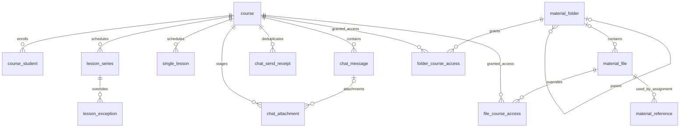

# Education Service — проект сущностей и таблиц PostgreSQL

**Дата:** 20.11.2026  
**Статус:** согласованная логическая модель MVP на 15 таблиц; SQL/Flyway-миграции и технические оптимизации ещё предстоит реализовать. Базовые REST/WebSocket-контракты приняты.  
**Основа:** текущие требования Education Service, согласованный алгоритм удаления, REST-контракт истории и решения по WebSocket/STOMP от 20.11.2026. Схема содержит 15 таблиц, включая технические результаты идемпотентной отправки.

> **Условные обозначения:** `*` — NOT NULL; `PK` — первичный ключ; `FK` — внешний ключ **в пределах БД Education**. UUID пользователей из Identity Service и идентификаторы сущностей Assignment Service хранятся как внешние идентификаторы **без SQL FK**. Технические значения статусов очистки — не статусы занятий.
>
> В колонках и примечаниях ниже различаются **утверждённая бизнес-логика** и **проектные предложения** (типы полей, структура и индексы).

## 1. Курсы и зачисления

### `course`
Курс одновременно является группой. У каждого курса один преподаватель-владелец; админу доступны все курсы.

| Поле | Тип | Ограничения и смысл |
| --- | --- | --- |
| `id` | uuid | **PK** |
| `teacher_id` | uuid | * UUID пользователя в Identity Service; **не FK** |
| `title` | text | * Название (не уникально), можно менять |
| `meeting_url` | text | NULL; будущая постоянная ссылка Телемоста, интеграция отложена |
| `chat_mode` | text | * `NORMAL` / `ANNOUNCEMENTS`, default `NORMAL` |
| `deletion_state` | text | * `ACTIVE` / `DELETING`, default `ACTIVE`; техническое состояние асинхронного удаления |
| `created_at` | timestamptz | * Время создания |

**Удаление курса входит в текущую реализацию.** В транзакции обработки запроса на удаление устанавливаем `deletion_state = 'DELETING'` и создаём `cleanup_job` типа `COURSE`; после завершения очистки строка удаляется физически. Все чтения и изменения курса должны учитывать `deletion_state`, включая проверку при конкурентных загрузках/записях. У курса нет `subject_id`, `workspace_id`, описания, предмета или отдельных сущностей `group`, `chat`.

### `course_student`
Только актуальные зачисления. История членства не хранится.

| Поле | Тип | Ограничения и смысл |
| --- | --- | --- |
| `course_id` | uuid | * **PK**, **FK → course(id)** |
| `student_id` | uuid | * **PK**, внешний UUID из Identity, **не FK** |
| `can_send_messages` | boolean | * Default `true`; запрет действует только в данном курсе |
| `enrolled_at` | timestamptz | * Время текущего зачисления |

**PK:** `(course_id, student_id)`. Исключение — физическое удаление строки; повторное зачисление возвращает `can_send_messages=true`. Старые сообщения сохраняются. После блокировки пользователя в Identity членство сохраняется; признак блокировки получаем из Identity, а не дублируем как источник истины.

## 2. Расписание

Выбрана модель **разовое занятие + бессрочная серия + исключение**. У виртуального вхождения регулярной серии есть конкретные `starts_at` и `ends_at`, но оно рассчитывается по правилу; отдельной строки на каждый будущий урок нет.

### `lesson_series`

| Поле | Тип | Ограничения и смысл |
| --- | --- | --- |
| `id` | uuid | **PK** |
| `course_id` | uuid | * **FK → course(id)** |
| `start_date` | date | * Начало действия в Europe/Moscow |
| `weekdays` | smallint[] | * Непустые уникальные ISO-дни 1=пн..7=вс |
| `start_time` | time without time zone | * Московское локальное время начала |
| `duration_minutes` | smallint | * `CHECK (duration_minutes BETWEEN 5 AND 300)` |
| `stop_from_date` | date | NULL; с этой московской даты **не формируются исходные вхождения** с `original_date >= stop_from_date`; ранее перенесённые с меньшей исходной датой остаются |
| `created_at` | timestamptz | * |

Пока правило активно, `stop_from_date IS NULL`. Изменять всю серию через операцию редактирования занятия нельзя; остановить бессрочную серию с выбранной даты можно отдельно. Для нескольких дней недели с одинаковым временем используется одно правило; разные времена — разные правила.

### `single_lesson`

| Поле | Тип | Ограничения и смысл |
| --- | --- | --- |
| `id` | uuid | **PK** |
| `course_id` | uuid | * **FK → course(id)** |
| `starts_at` | timestamptz | * Момент начала (UTC при сериализации) |
| `ends_at` | timestamptz | * Момент окончания |
| `created_at` | timestamptz | * |

`CHECK (ends_at > starts_at AND ends_at <= starts_at + interval '5 hours' AND ends_at >= starts_at + interval '5 minutes')`. Перенос разового занятия изменяет `starts_at`/`ends_at`, публикуя событие с прежними значениями через outbox. **Отмена разового занятия:** физически удалить строку в транзакции и записать событие отмены в outbox; восстановление через API не поддерживать. Отдельного поля `status` у занятия нет.

### `lesson_exception`

| Поле | Тип | Ограничения и смысл |
| --- | --- | --- |
| `id` | uuid | **PK** |
| `series_id` | uuid | * **FK → lesson_series(id)** |
| `original_date` | date | * Локальная дата **исходного вхождения** по правилу |
| `kind` | text | * `RESCHEDULED` / `CANCELLED`; **тип исключения, не статус занятия** |
| `new_starts_at` | timestamptz | NULL для `CANCELLED`, * для `RESCHEDULED` |
| `new_ends_at` | timestamptz | NULL для `CANCELLED`, * для `RESCHEDULED` |
| `reason` | text | NULL; необязательная причина |
| `created_at` | timestamptz | * |

**UNIQUE:** `(series_id, original_date)`. Для изменённого занятия исходный ключ `(series_id, original_date)` остаётся стабильным даже после нескольких переносов. При `CANCELLED` оба новых времени NULL; при `RESCHEDULED` оба заданы, и длительность 5–300 минут. Исключения отмены не удаляются ради восстановления; отменённое занятие больше не появляется при расчёте календаря. Когда серия остановлена, обычные вхождения с `original_date >= stop_from_date` не создаются. **Ранее перенесённые вхождения, где `original_date < stop_from_date`, сохраняются** даже если `new_starts_at` позже даты остановки; в календаре они отображаются по `new_starts_at`. Например, перенос 15→25 декабря остаётся при остановке с 20 декабря. Отменённые вхождения не отображаются.

**Важно:** проверка пересечений у преподавателя и всех зачисленных учеников — бизнес-процесс, а не уникальный индекс БД. Конфликты **разрешены после предупреждения**. Для новой серии проверяются ближайшие 30 дней. В интерфейсе календарь на месяц. В БД разовые моменты `timestamptz`, правило хранит локальную дату/время в Europe/Moscow.

## 3. Библиотека преподавателя и права

### `material_folder`

| Поле | Тип | Ограничения и смысл |
| --- | --- | --- |
| `id` | uuid | **PK** |
| `teacher_id` | uuid | * UUID из Identity; **не FK** |
| `parent_id` | uuid | NULL для корня, **FK → material_folder(id)** |
| `name` | text | * Имя папки |
| `state` | text | * `ACTIVE` / `DELETING` |
| `created_at` | timestamptz | * |

Проверяем, что папка-родитель принадлежит тому же преподавателю; не допускаем циклов при перемещении папки. Вариант дополнительного уникального индекса на `(teacher_id, parent_id, name)` с `NULLS NOT DISTINCT` — проектное решение, если запретим папки с одинаковым именем внутри одной папки.

### `material_file`

| Поле | Тип | Ограничения и смысл |
| --- | --- | --- |
| `id` | uuid | **PK** |
| `teacher_id` | uuid | * Владелец-учитель, **не FK** к Identity |
| `folder_id` | uuid | NULL для корня, **FK → material_folder(id)** |
| `name` | text | * Отображаемое имя файла |
| `object_key` | text | * UNIQUE; уникальный, неизменяемый ключ объекта в MinIO |
| `mime_type` | text | * MIME-тип |
| `size_bytes` | bigint | * `CHECK (size_bytes >= 0)` |
| `state` | text | * `ACTIVE` / `DELETING` |
| `created_at` | timestamptz | * |

Metadata учебных файлов хранится отдельно от вложений чата: разные жизненный цикл, проверки доступа и правила использования. Все загрузки идут через backend; незавершённые объекты создаются во временной зоне и публикуются в `material_file` только после повторной проверки активности папки/владельца. Выделенная таблица для временных загрузок обсуждается в секции «Загрузка».

### `folder_course_access`
Грант папки для курса; наследуется всеми вложенными папками и файлами.

| Поле | Тип | Ограничения |
| --- | --- | --- |
| `folder_id` | uuid | * **PK, FK → material_folder(id)** |
| `course_id` | uuid | * **PK, FK → course(id)** |

**PK:** `(folder_id, course_id)`. Здесь храним только **разрешения** (наличие строки = чтение разрешено). Правила доступа к курсу может менять только преподаватель-владелец материала либо администратор. Для простоты не делаем отдельные ограничения на промежуточных папках: грант любой папки предков разрешает чтение потомков, пока на самом файле нет явного правила.

### `file_course_access`
Приоритетный override доступа на конкретный файл.

| Поле | Тип | Ограничения |
| --- | --- | --- |
| `file_id` | uuid | * **PK, FK → material_file(id)** |
| `course_id` | uuid | * **PK, FK → course(id)** |
| `allow_read` | boolean | * `true` = разрешить, `false` = запретить |

**PK:** `(file_id, course_id)`. Правило получения доступа для конкретного ученика:
1. Проверить текущее членство ученика в курсе (либо права владельца/администратора).
2. Если имеется явная строка `(file_id, course_id)` — использовать `allow_read`.
3. Иначе искать разрешение курса на текущую папку файла или любого её предка.
4. Если грантов нет — отказать.

Если ученик состоит в нескольких курсах, достаточно **хотя бы одного** курса с разрешением; явный отказ для одного курса не запрещает доступ, полученный через другой курс. Перемещение файла без собственного override меняет эффективный доступ в соответствии с новой папкой. Доступ к файлу в задании Assignment требует самостоятельного контекста авторизации, не только записи `material_reference`.

### `material_reference`
Реестр внешних использований файла в Assignment Service, блокирующий физическое удаление.

| Поле | Тип | Ограничения и смысл |
| --- | --- | --- |
| `id` | uuid | **PK**; стабильный ID ссылки, используется при повторах API |
| `file_id` | uuid | * **FK → material_file(id)** |
| `consumer_service` | text | * Сейчас `ASSIGNMENT` |
| `consumer_entity_id` | uuid | * UUID задания/объекта Assignment, **не FK** |
| `created_at` | timestamptz | * |

**UNIQUE:** `(file_id, consumer_service, consumer_entity_id)`, если одна связь «задание ↔ файл» хранится единожды. Assignment регистрирует ссылку до публикации задания; при удалении или отвязке освобождает её. **Регистрация ссылки и переход файла в `DELETING` блокируют одну и ту же строку `material_file`**. Перед удалением папки нужно проверить ссылки всех дочерних файлов и заблокировать соответствующую подструктуру от конкурентных изменений/новых регистраций.

## 4. Чат курса

Отдельная строка `chat` не требуется: chat_mode у `course`, messages ссылаются на `course_id`.

### `chat_message`

| Поле | Тип | Ограничения и смысл |
| --- | --- | --- |
| `id` | uuid | **PK** |
| `course_id` | uuid | * **FK → course(id)** |
| `author_id` | uuid | * Автор из Identity, **не FK** |
| `author_role` | text | * `STUDENT` / `TEACHER` / `ADMIN` — роль автора **в сообщении**, снимок |
| `author_display_name` | text | * **Утверждено:** снимок отображаемого имени автора на момент отправки; не обновляется при смене ФИО в Identity |
| `body` | text | NULL, если сообщение только с вложениями; максимум **4000 символов**, `CHECK (body IS NULL OR char_length(body) <= 4000)` |
| `client_message_id` | uuid | * UUID, сгенерированный frontend и повторяемый при retry |
| `state` | text | * `ACTIVE` / `DELETING`; техническая фаза удаления |
| `created_at` | timestamptz | * Серверное время отправки |

Содержимое `body` или хотя бы одно готовое вложение **обязательно**, но это межтабличная проверка на уровне отправки сообщения. `body` не редактируется, `reply_to_id` нет. Ученик не удаляет собственные сообщения; преподаватель удаляет свои и учеников своего курса; администратор — любые. Признак блокировки автора не копируем в таблицу сообщения.

**Индексы:** `(course_id, created_at DESC, id DESC) WHERE state = 'ACTIVE'` для истории; дополнительный `UNIQUE (course_id, author_id, client_message_id)` — защита от повторной записи, пока сообщение существует. Для повторов после физического удаления сохраняем техническую запись в `chat_send_receipt` (без текста сообщения). Контракт истории: `limit=50` по умолчанию, максимум 100, курсор `(created_at,id)` с непрозрачной сериализацией. Текущий участник читает все сообщения независимо от даты зачисления. Успешный ACK допустим только после коммита сообщения и receipt.

### `chat_attachment`
Одна строка представляет один объект MinIO. До публикации сообщения может находиться в стадии временной загрузки.

| Поле | Тип | Ограничения и смысл |
| --- | --- | --- |
| `id` | uuid | **PK** |
| `course_id` | uuid | * **FK → course(id)** |
| `message_id` | uuid | NULL до прикрепления; **FK → chat_message(id)** |
| `uploader_id` | uuid | * UUID пользователя Identity, **не FK** |
| `object_key` | text | * UNIQUE; приватный уникальный ключ MinIO |
| `original_name` | text | * Имя загруженного файла |
| `mime_type` | text | * MIME-тип |
| `size_bytes` | bigint | * неотрицательное значение; для вложений чата **size_bytes <= 20 000 000** (20 десятичных МБ) |
| `upload_state` | text | * `UPLOADING` / `READY` / `ATTACHED` / `DELETING` |
| `created_at` | timestamptz | * |
| `expires_at` | timestamptz | NULL для `ATTACHED`; для временных состояний — `created_at + interval '24 hours'` |

**Ограничения на уровне сервиса/транзакции:** вложение может быть прикреплено только к сообщению своего курса, загружено автором сообщения, в состоянии `READY`; при связывании переводится в `ATTACHED`. В одном сообщении **не более 5 вложений, суммарно не более 50 МБ = 50 000 000 байт** (сумму проверяем в транзакции отправки), каждый файл **не более 20 МБ = 20 000 000 байт**. Разрешённые расширения: **JPG/JPEG, PNG, WEBP, PDF, DOCX, XLSX, TXT**, с серверной проверкой MIME и формата. Один файл не разделяется между несколькими сообщениями. Запись создаётся **до** передачи объекта в MinIO. Доступ к файлу только через Education backend после проверки членства и активного состояния сообщения. **Неприкреплённые временные файлы истекают через 24 часа**; cleanup учитывает активные upload и возможные поздние завершения: один TTL сам по себе не устраняет race.

**Отправка:** WebSocket/STOMP передаёт текст и готовые `attachmentIds`, а не бинарные файлы. `MESSAGE_ACCEPTED` с `clientMessageId` и `messageId` отправляется **после коммита**. `MESSAGE_CREATED` доставляется участникам курса после коммита; потеря событий при разрыве лечится повторной загрузкой REST-истории, **таблицу `chat_event` не вводим**.

### `chat_send_receipt` (техническая дедупликация)
Результат принятой команды отправки. Нужен, чтобы повторный `clientMessageId` **после физического удаления** исходного сообщения не создал новое сообщение. Текст, имена файлов и бинарные данные здесь не храним.

| Поле | Тип | Ограничения и смысл |
| --- | --- | --- |
| `course_id` | uuid | * **PK**, FK → `course(id)`; удаляется при окончательном удалении курса |
| `author_id` | uuid | * **PK**, UUID Identity, не SQL FK |
| `client_message_id` | uuid | * **PK**, UUID, заданный клиентом |
| `message_id` | uuid | * UUID первоначально созданного сообщения; **не FK** к `chat_message`, поскольку сообщение может быть физически удалено |
| `request_hash` | text | * Контрольная сумма канонической команды отправки (текст + список attachment IDs) для выявления конфликта при reuse client ID; желательно keyed hash, чтобы не сохранять узнаваемые хеши коротких текстов |
| `created_at` | timestamptz | * Время успешного создания сообщения |

**PK:** `(course_id, author_id, client_message_id)`; достаточно для атомарного UPSERT/конфликта в PostgreSQL. `chat_message` и `chat_send_receipt` создаются **в одной транзакции**. При повторе с тем же payload возвращаем сохранённый `message_id` (либо сообщаем, что сообщение уже удалено), не создавая новое; с другим payload — конфликт. **Проверку повторного `clientMessageId` выполняем до проверки `READY` у вложений:** после первой отправки они уже `ATTACHED` и не должны ломать идемпотентный retry. Проверку полномочий и состояния курса при этом не пропускаем. Запись receipt не является сохранённым сообщением, не предоставляется пользователям и удаляется вместе с курсом. **Принятая политика MVP:** receipts храним до физического удаления курса, **без отдельного TTL**. Поэтому гарантия дедупликации сохраняется на срок существования курса; при удалении курса строки удаляются вместе с ним.

## 5. Служебные таблицы

### `cleanup_job`
Долговечная очередь асинхронного удаления MinIO + PostgreSQL. Используется **уже сейчас** для удаления курсов, файлов, папок и сообщений с вложениями.

| Поле | Тип | Ограничения и смысл |
| --- | --- | --- |
| `id` | uuid | **PK** |
| `resource_type` | text | * `COURSE` / `CHAT_MESSAGE` / `MATERIAL_FILE` / `MATERIAL_FOLDER` |
| `resource_id` | uuid | * ID удаляемой сущности; **без FK**, поскольку сущность затем исчезнет |
| `status` | text | * `PENDING` / `PROCESSING` / `COMPLETED` / `FAILED` |
| `attempts` | integer | * Default 0 |
| `next_attempt_at` | timestamptz | * |
| `locked_until` | timestamptz | NULL |
| `lease_token` | uuid | NULL; защита финализации от старого worker |
| `last_error` | text | NULL |
| `created_at` | timestamptz | * |
| `updated_at` | timestamptz | * |

**Индексы:** по `(status, next_attempt_at)` для готовых задач; уникальность незавершённой задачи `(resource_type, resource_id)` с partial unique index для `status IN ('PENDING','PROCESSING','FAILED')`. Worker захватывает задания через короткую транзакцию `FOR UPDATE SKIP LOCKED`, назначает lease, работает с MinIO вне транзакции, затем завершает задачу при совпадении токена. Удаление объектов идемпотентное. `COMPLETED`-строка может сохраняться как техническая история задачи.

**Для `resource_type='COURSE'`:** инициирование включает транзакционное изменение `course.deletion_state` и создание задания; возвращаем `202 Accepted`. Worker не допускает публикации новых вложений, начатых до удаления, очищает все файлы чата из MinIO и лишь затем в финальной транзакции удаляет сообщения/вложения, расписание (разовые занятия, правила и исключения), членства, разрешения курса к материалам и сам `course`, отмечая задачу `COMPLETED`. Учебные файлы библиотеки и ссылки `material_reference` остаются. Задание очистки не должно каскадно удаляться вместе с курсом.

### `outbox_event`
Надёжная публикация Kafka-событий о переносах, отменах и остановке правил; опционально — отправка post-commit уведомлений WebSocket. **Не используется как журнал catch-up для клиентов**.

| Поле | Тип | Ограничения и смысл |
| --- | --- | --- |
| `id` | uuid | **PK** |
| `aggregate_type` | text | * Например `LESSON`, `LESSON_SERIES` |
| `aggregate_id` | uuid | * ID объекта/правила; для виртуальных вхождений требуется ключ серии + исходная дата в payload |
| `event_type` | text | * Например `LessonRescheduled`, `LessonCancelled`, `LessonSeriesStopped` |
| `payload` | jsonb | * Данные события, включая ID курса, исходное/новое время и причину при наличии |
| `created_at` | timestamptz | * |
| `published_at` | timestamptz | NULL до подтверждения отправки |

Вставляем outbox-событие в той же транзакции, что и изменение расписания. Публикация в Kafka — **at least once**; получателям нужна дедупликация по `event.id`. Отправка/удаление чата при необходимости могут использовать тот же outbox для post-commit доставки STOMP-событий, **но это не журнал `chat_event` и не API воспроизведения пропущенных событий**: после reconnect frontend повторно получает историю через REST. Минимальные STOMP destinations и JSON payload `MESSAGE_ACCEPTED` / `MESSAGE_REJECTED` / `MESSAGE_CREATED` / `MESSAGE_DELETED` приняты в `chat_websocket_contract.md`. Схемы событий Kafka для уведомлений остаются отдельной задачей.

## 5.1. Границы удаления курса и межсервисные зависимости

- `course.deletion_state = 'DELETING'` исключает курс из пользовательских запросов и блокирует новые записи во всех связанных подсистемах Education. Повторный DELETE переиспользует существующую незавершённую задачу `COURSE`.
- Прежде чем физически удалить `course`, необходимо завершить очистку его вложений в MinIO. SQL FK-зависимости (`chat_attachment`, `chat_message`, `lesson_exception` через `lesson_series`, `single_lesson`, `course_student`, `folder_course_access`, `file_course_access`) удаляем в согласованном порядке или контролируемыми каскадами **в финальной транзакции**.
- `material_folder`, `material_file` и `material_reference` **не удаляются** при удалении курса: удаляются только связанные с курсом записи доступа.
- Assignment находится в другой БД и не связан с `course` физическим FK. **Судьба домашних заданий, решений и оценок при удалении курса пока не определена**; она будет согласована на этапе Assignment Service. В существующей модели нельзя предполагать, что `ON DELETE CASCADE` очистит данные Assignment.

## 6. Связи

> Диаграмма концептуальная: связи с Identity/Assignment только по ID; не каждая связь имеет SQL FOREIGN KEY. На диаграмме у `chat_attachment` связь с `chat_message` необязательна до прикрепления; `material_folder` может быть корневой; `cleanup_job` и `outbox_event` независимы от удаляемых строк и намеренно не имеют каскадных FK.

## 7. Перечень таблиц

| Блок | Таблицы |
| --- | --- |
| Курсы | `course`, `course_student` |
| Расписание | `lesson_series`, `single_lesson`, `lesson_exception` |
| Материалы | `material_folder`, `material_file`, `folder_course_access`, `file_course_access`, `material_reference` |
| Чат | `chat_message`, `chat_attachment`, `chat_send_receipt` |
| Инфраструктура | `cleanup_job`, `outbox_event` |

**Итого: 15 таблиц**. Дополнительная общая таблица `stored_file`, как на референсной диаграмме, пока не нужна: чат и библиотека имеют разную семантику доступа/удаления. Когда это понадобится, слой физических объектов можно выделить без изменения бизнес-понятий.

## 8. Важные ограничения и индексы

1. `course (teacher_id, id)` — список курсов преподавателя; отдельная индексация `course_student (student_id, course_id)` — список курсов ученика и проверка членства.
2. `lesson_series (course_id)` и `single_lesson (course_id, starts_at)` — календарь месяца; `lesson_exception (series_id, original_date)` — уникальное исключение на вхождение.
3. `chat_message (course_id, created_at DESC, id DESC) WHERE state='ACTIVE'` — курсорная история; `UNIQUE (course_id, author_id, client_message_id)` и PK `chat_send_receipt (course_id, author_id, client_message_id)` — дедупликация. `chat_attachment (message_id)` и индекс на временные `expires_at` — получение и 24-часовая очистка временных вложений.
4. `material_folder (teacher_id, parent_id)`, `material_file (teacher_id, folder_id)`, `folder_course_access (course_id)`, `file_course_access (course_id)`, `material_reference (file_id)` — дерево, права, блокировка удаления.
5. `cleanup_job (status, next_attempt_at)` и уникальность незавершённого удаления по ресурсу; `outbox_event (created_at) WHERE published_at IS NULL` — фоновая обработка.
6. Взаимодействия с MinIO выполняются **после коммита** перевода ресурса в `DELETING`; ключи объектов не теряем до подтверждённого удаления; временные upload-записи/объекты очищаем отдельно.
7. Для разных курсов **разрешены одинаковые названия**, так что `UNIQUE(title)` не нужен.
8. Проверки принадлежности папки/файла тому же учителю и ограничение циклов папок требуют логики сервиса/транзакций; простой FK не гарантирует этого полностью.
9. Для `lesson_series.weekdays` дополнительно проверяем массив (1..7, непустой, без повторов) в приложении или SQL CHECK с проверочной функцией.

## 9. Границы утверждённого MVP и технические вопросы

**Согласовано:**

- Регулярная серия бессрочная; её остановка с `stop_from_date` исключает исходные вхождения начиная с этой даты. Переносы с `original_date` **до** даты остановки сохраняются и отображаются в новом фактическом времени.
- Базовые маршруты, DTO и HTTP-статусы REST-контракта приняты. Для `POST` создания курсов и занятий не требуется обязательный `Idempotency-Key`; не обещаем идемпотентность сетевых повторов этих операций.
- Для MVP нет публичного API просмотра `cleanup_job` по ID; `202 Accepted` + сразу скрытый ресурс. Долговечная задача и worker сохраняются.
- Для чата утверждены STOMP destinations и JSON-ответы из `chat_websocket_contract.md`, `clientMessageId` и `chat_send_receipt` **без TTL до удаления курса**; восстановление через REST, **без `chat_event`**.
- Для вложений чата утверждены JPG/JPEG/PNG/WEBP/PDF/DOCX/XLSX/TXT, 20 000 000 байт/файл, максимум 5 файлов и 50 000 000 байт суммарно, 4000 символов текста и TTL временных файлов 24 часа. `author_display_name` — снимок имени; администратор пишет и в `ANNOUNCEMENTS`.

**Техническая реализация / следующие этапы:**

- Для временных загрузок **учебной библиотеки** уточнить хранение промежуточных метаданных (например, `pending_upload`) и безопасную очистку прерванных загрузок. Нельзя публиковать файл после начала удаления папки.
- Для `material_reference` при проектировании Assignment уточнить критерий использования (в том числе старые версии заданий), сверку ссылок и реакцию на удаление курса. **Удаление самого курса делаем сейчас.**
- Значения retry/backoff/lease и мониторинг cleanup worker — технические настройки, не изменение модели бизнес-правил.
- Автоматическое создание постоянной ссылки Телемоста отложено.

## 10. Рекомендуемый порядок реализации

1. `course`, `course_student` и авторизация владельца/администратора.
2. `lesson_series`, `single_lesson`, `lesson_exception`, генерация календаря и проверка конфликтов.
3. `material_folder`, `material_file`, ACL и `material_reference`.
4. `chat_message`, `chat_attachment`, `chat_send_receipt`, REST-история и WebSocket/STOMP с ACK после коммита; проверка лимитов вложений и 24-часовая очистка временных файлов.
5. `cleanup_job`, worker и `outbox_event`; **реализовать удаление курса сейчас** через `deletion_state = DELETING` и задачу `COURSE`, с асинхронным удалением вложений чата из MinIO и физической очисткой связанных таблиц.
6. Интеграцию с Assignment и правила судьбы домашних заданий при удалении курса согласовать на этапе проектирования Assignment Service — **не блокировать этим реализацию удаления курса в Education**.
