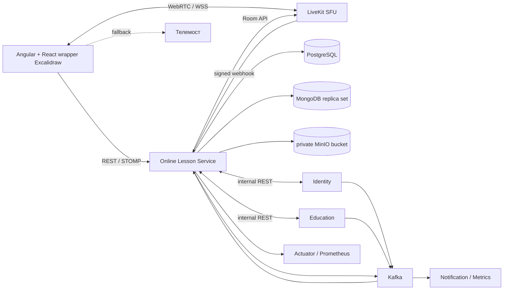

# Online Lesson Service — архитектура

## 1. Компоненты и развёртывание

Java 17, Spring Boot версии существующего проекта, Gradle Kotlin DSL, Spring Security, JPA/JDBC, Flyway, MongoDB driver/Spring Data, Spring WebSocket/STOMP simple broker, Kafka, MinIO SDK, Actuator. Не обновлять остальные сервисы ради нового. Один экземпляр приложения, Redis не нужен. Отдельная SQL DB/user, отдельная Mongo DB/user, MinIO bucket/credentials; Kafka ACL. Mongo single-node replica set локально (не HA). Конфигурация production отдельно, не считать dev compose безопасным для внешней сети. LiveKit самостоятельно маршрутизирует media; Spring не проксирует RTP. HTTPS/WSS, правильный внешний адрес SFU, ICE/UDP/TCP/TURN и firewall проверяются в PoC. Секреты отдельно от JWT Identity; /internal не публикуется через gateway. Webhook доступен только для LiveKit с проверенной подписью.

## 2. Модули
`lifecycle`, `participant`, `presence`, `media`, `board`, `chat`, `storage`, `integration`, `jobs`, `events`, `security`, `common`. Controller/STOMP adapter → application service → repositories/integration ports. Не делить на дополнительные микросервисы. PostgreSQL — lifecycle/rights/history/jobs/events, Mongo — только board, MinIO — bytes, process memory — ephemeral cursors/hand/viewport/page presence/queues/rate limits. Не считать память источником durable ACK.

## 3. Сериализация и межхранилищные границы
Единая bounded per-lesson command lane для всех изменений доски, прав, участника, kick, lifecycle finish, обработки значимых Kafka/webhook переходов и завершения upload. Общий bounded executor, не поток на урок; fairness, очередь переполнена → 429/WS OVERLOADED без ACK. Не помещать cursor/heartbeat flood в durable очередь; heartbeat обновляет timestamp с проверкой текущей сессии. Локальные SQL-операции под lock online_lesson → participant → connection/file/job; не держать SQL lock во время внешнего I/O. Mongo transaction в lane; пока outcome неизвестен, reconcile receipt и блокировать конфликтующий переход до определённости либо fail closed. Внешняя подготовка upload/room может идти вне lane, а публикация результата только при актуальном state/lease/generation. При restart очистить локальное присутствие и проверить SQL/Mongo до admission. Single instance enforced deployment, не полагаться на per-JVM locks при rolling overlap.

## 4. Start saga
1. Validate teacher, Education resolve, time; SQL STARTING + unique occurrence/teacher + durable START_LESSON, стабильные lessonId и board/page IDs. Повтор start возвращает существующий результат, не создаёт новые попытки при неизвестном результате.
2. Education guard reserve с lessonId, проверкой occurrence, актуального владельца и окна, под общим lock со schedule mutations. Ответ authoritative roster/times. Identity batch. Удаление курса может победить guard; recheck до activation и затем event/reconcile. Не заявлять глобальную атомарность с блокировкой Identity.
3. Создать board + first page в одной Mongo transaction с предопределёнными ID. Проверить ownership/idempotent shape. Запустить media provisioning независимо; до ACTIVE token не выдавать.
4. В lane SQL ACTIVE, snapshot roster, actualStartsAt, deadlines, teacher_absent_since по наблюдению, outbox Started. Повторная проверка окна и guard перед commit. При timeout 5 min/истечении окна/невалидном курсе: START_FAILED, durable compensation закрывает media, удаляет board, release guard tombstone. До окончания компенсации новый запуск того же occurrence запрещён. Поздний результат не публикуется; workers сверяют orphan resources. START_FAILED не считается фактом урока.

## 5. Finish saga
В lane и SQL lock проверить ACTIVE/STARTING; для ACTIVE фиксируем actualEndsAt (не позже hard deadline для статистики), закрываем интервалы и доступ, создаём Finished + AttendanceFinalized и jobs, статус FINISHING. STARTING при abort идёт в START_FAILED. Отключить subscriptions и выдачу JWT; очистка Mongo/MinIO/чат и закрытие всех поколений LiveKit/release guard — idempotent steps. Все steps подтверждены → COMPLETED. История доступна при FINISHING. Повтор finish возвращает текущий факт, не создаёт события. Ошибка cleanup не открывает доступ. Release guard не ждёт физической очистки, но новый start невозможен для успешного occurrence. Никакой XA/2PC. Команды после cutoff запрещены даже если lifecycle worker отстаёт.

## 6. Отказы и наблюдаемость
LiveKit отказ → board+Telemost; Mongo отказ ACTIVE → read-only/unavailable board, чат/видео продолжаются; Mongo отказ STARTING → retry; MinIO отказ → no new images; SQL отказ → закрыть прикладные мутации/выдачу токенов и приостановить доступ (media control best effort), Kafka outage → outbox. Identity/Education outage → fail closed для новых входов, freshness lease 60s для существующих. Не закрывать урок по ложному отсутствию при UNKNOWN; hard duration действует. Recovery после restart: pending jobs, stale leases, active lesson state, room/participants, board existence, auth refresh, open APP connections (не считать их автоматически живыми), reconcile orphan files. Не логировать JWT, чат, данные доски, изображения. Метрики bounded labels: active lessons/rooms, WS count, queues/rejections, board apply latency/conflict/resync, media error/webhook lag, presence UNKNOWN, jobs/outbox lag, cleanup age, authorization stale, storage errors. CorrelationId/lessonId только в структурированных логах. Liveness не зависит от внешних сервисов; readiness для PostgreSQL и способности безопасно принимать операции, degraded dependency health отдельно, не блокировать fallback из-за LiveKit.
